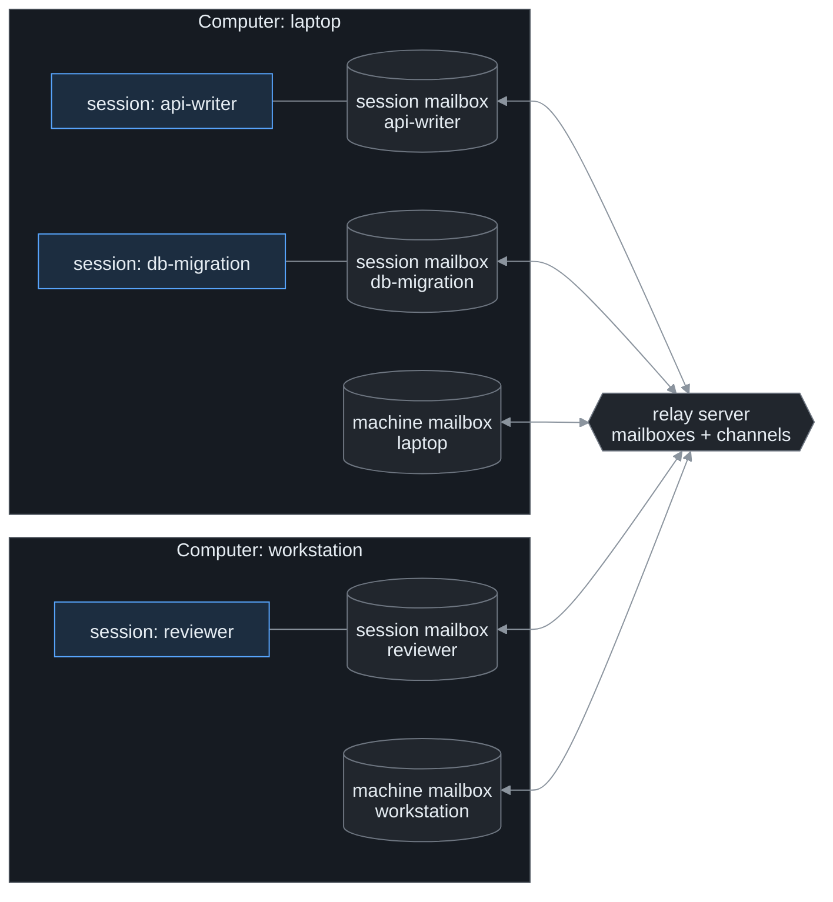
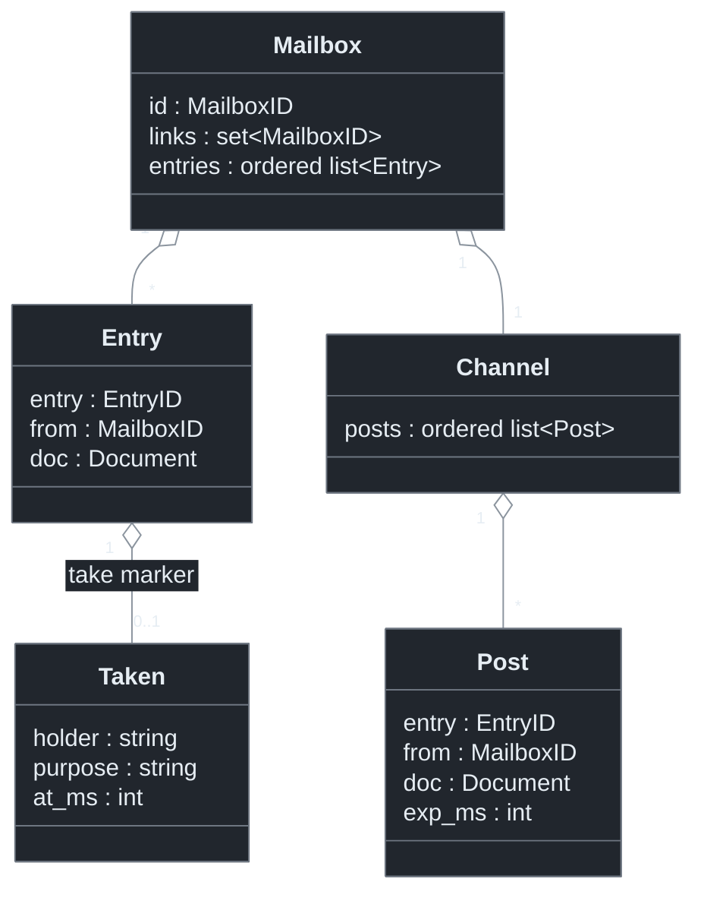
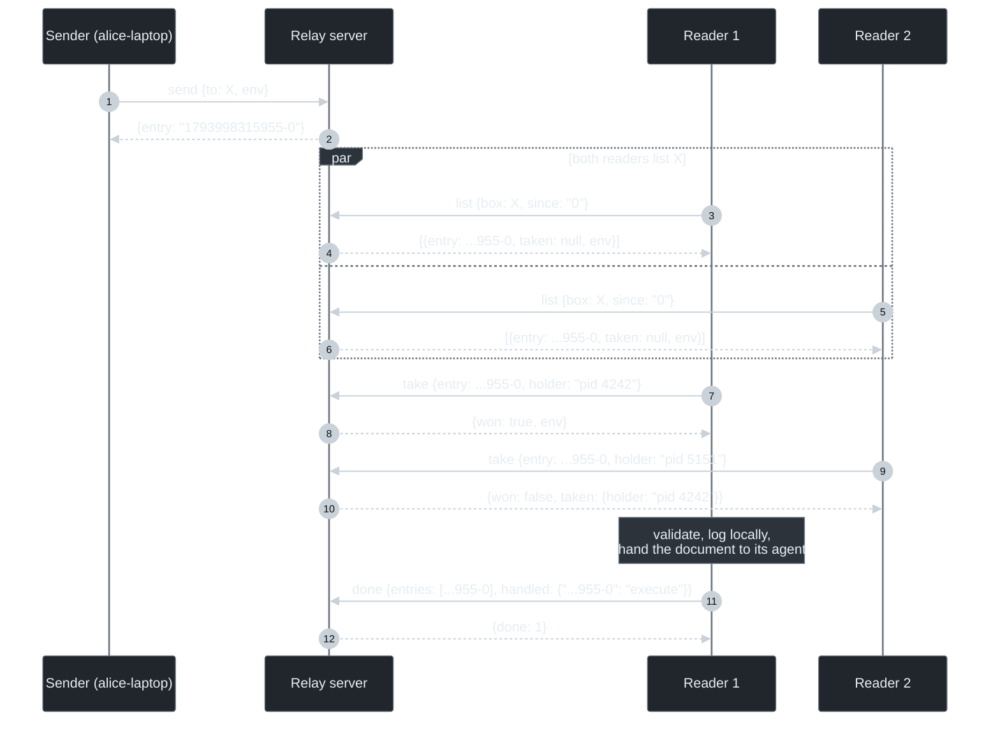
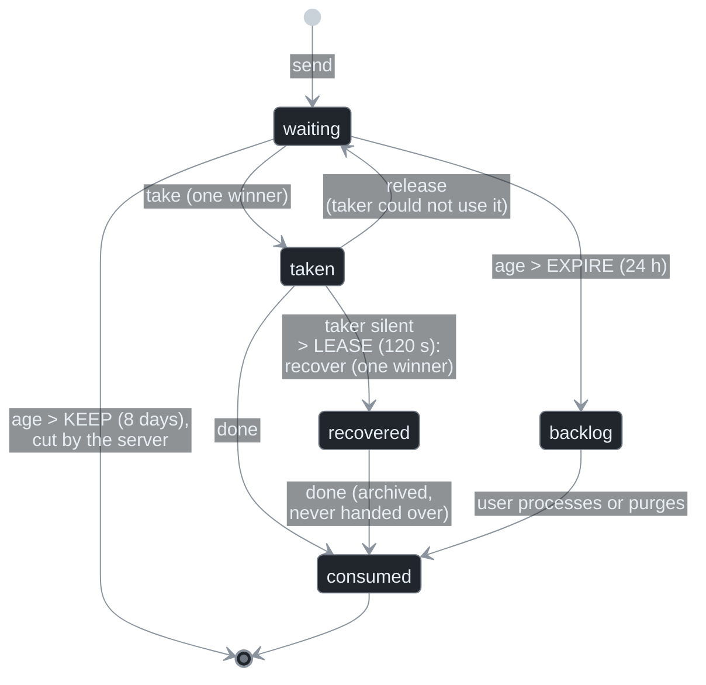
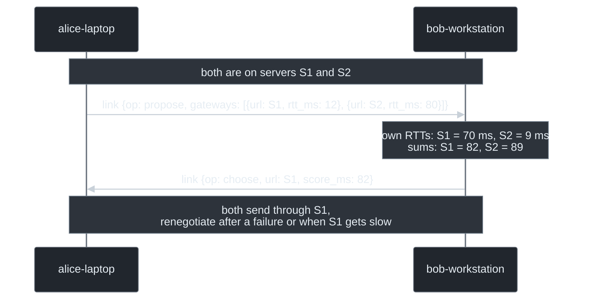
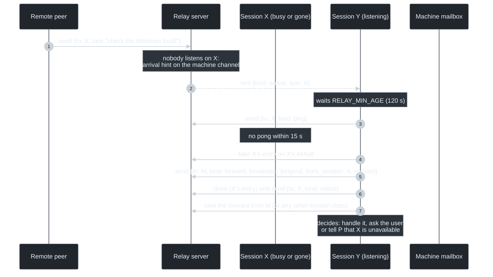
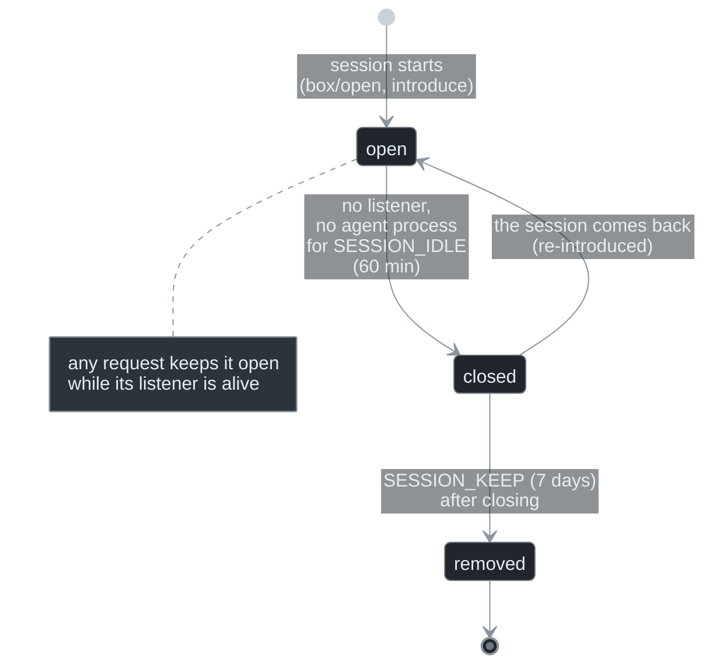
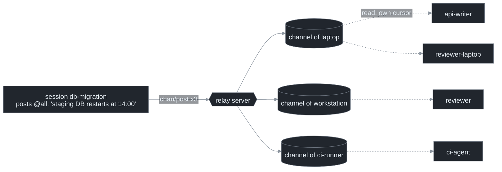

```
SDTP Working Draft                                               lp177
Category: Informational                                  November 2026
Version: 1 (draft-sdtp-01)


          SDTP: Sequential Document Transfer Protocol
              (the exchange, without its security layer)
```

## Abstract

SDTP lets autonomous programs, such as AI coding agents running in terminal sessions, hand each other documents: a task, a question, an answer, a piece of news.

- Each participant owns a **mailbox**. A small **relay server** keeps each mailbox as an append-only, ordered sequence of documents.
- A document is consumed **once**, by **one** reader, even when several readers watch the same mailbox. A reader that dies halfway through never causes a document to be handed over twice.
- Next to the mailboxes, short-lived **channels** carry broadcasts: read by every session of a computer, never consumed, gone after a minute.

This document describes the exchange alone: the actors, the documents, the operations of the relay server and the rules that turn them into reliable delivery. It deliberately leaves security out, so that the mechanics can be understood, tried on a single computer and implemented in an afternoon.

The secured profile, **SDTPS** (Sequential Document Transfer Protocol Secure), adds the rest: identities as key pairs, signed requests, end-to-end encrypted envelopes and pairing by a one-time code. It is specified separately, and every SDTPS implementation is an SDTP implementation with that layer added.

## Status of this memo

This is an informational draft describing a protocol in production use between AI agent sessions. It is not an Internet Standards Track document. Comments and implementations are welcome.

## Table of contents

1. [Introduction](#1-introduction)
2. [Conventions and terminology](#2-conventions-and-terminology)
3. [Architecture](#3-architecture)
4. [Identifiers and time](#4-identifiers-and-time)
5. [Documents](#5-documents)
6. [The relay server](#6-the-relay-server)
7. [Delivery: take, done, recover](#7-delivery-take-done-recover)
8. [Several servers for one mailbox](#8-several-servers-for-one-mailbox)
9. [Machine mailbox and session mailboxes](#9-machine-mailbox-and-session-mailboxes)
10. [Channels: ephemeral broadcasts](#10-channels-ephemeral-broadcasts)
11. [Listening: long polls and arrival hints](#11-listening-long-polls-and-arrival-hints)
12. [The table of active mailboxes](#12-the-table-of-active-mailboxes)
13. [Ageing: backlog, expiry, retention](#13-ageing-backlog-expiry-retention)
14. [Handling policies](#14-handling-policies)
15. [A local walk-through](#15-a-local-walk-through)
16. [Errors](#16-errors)
17. [Constants](#17-constants)
18. [Security considerations](#18-security-considerations)
19. [Appendix A: SDTP over a shared directory](#appendix-a-sdtp-over-a-shared-directory)
20. [Appendix B: from SDTP to SDTPS](#appendix-b-from-sdtp-to-sdtps)

---

## 1. Introduction

AI agents increasingly work side by side. Several of them may run on one laptop: one per terminal, one per project, a code reviewer next to a code writer. Others run on a colleague's workstation, on a build server or in the cloud. They have useful things to tell each other:

> *"The release is out, you can deploy."*<br>
> *"Can you check why the Windows build fails? Here are the logs."*<br>
> *"Who is touching `package-lock.json` right now?"*

Chat platforms, ticket trackers and shared files all fall short. Agents need something **addressable** (this exact session, or whoever is on that computer), **reliable** (handed over once, never lost because a terminal closed), **quiet** (no wake-up for chatter nobody needs) and **simple enough** for a script to speak.

SDTP is that something. Its whole design fits in four ideas:

1. **A mailbox is a sequence.** Documents are appended in arrival order and read in that order. *Sequential* is the S in SDTP.
2. **Reading is not consuming.** Anyone allowed may *list* a mailbox; exactly one reader may *take* an entry; only the taker *deletes* it, once the document is safely handed over.
3. **Sessions come and go; computers stay.** Each computer has a long-lived *machine mailbox*. Each agent session has its own *session mailbox*. A document left in a silent session's mailbox is relayed to the machine mailbox, where another session picks it up.
4. **Broadcasts are not messages.** "Everyone on this computer, FYI" goes to a *channel*: read by all, consumed by nobody, gone in a minute.

> **What this enables.** An agent finishing a database migration on your laptop tells the agent writing the API, two terminals away: "schema v42 is live, regenerate the models". The message waits safely if that agent is busy, and it reaches its machine mailbox if the terminal was closed. No human copy-paste, no polling loop, no lost message.

## 2. Conventions and terminology

The key words MUST, MUST NOT, REQUIRED, SHALL, SHALL NOT, SHOULD, SHOULD NOT, RECOMMENDED, NOT RECOMMENDED, MAY and OPTIONAL are to be interpreted as described in BCP 14 (RFC 2119, RFC 8174) when, and only when, they appear in all capitals.

| Term | Meaning |
|---|---|
| **Agent** | A program that sends and receives documents: typically an AI agent in a terminal session, but any script qualifies. |
| **Mailbox** (box) | An addressable endpoint, named by a Mailbox ID. It holds the documents written to it until they are consumed. |
| **Machine mailbox** | The long-lived mailbox of a computer, shared by every agent session on it: whoever takes a document handles it. |
| **Session mailbox** | The mailbox of one agent session. It opens with the session and closes when the session goes idle. |
| **Relay server** (server) | The program that stores mailboxes and channels and answers the operations of section 6. |
| **Document** | A JSON object written by one mailbox to another: the unit of exchange (section 5). |
| **Entry** | A document as stored in a mailbox, with its Entry ID (its place in the sequence). |
| **Peer** | A mailbox that another mailbox accepts documents from. |
| **Links** | The list of peers a mailbox publishes on a server: who may write to it. |
| **Channel** | The broadcast stream attached to a mailbox, read without being consumed (section 10). |
| **Taker** | The one reader that won an entry with `take`. |
| **Listener** | A process that waits for news on a mailbox (section 11). |

JSON is RFC 8259 JSON in UTF-8. All times on the wire are UTC.

## 3. Architecture



- The **relay server** is the only shared component. It stores mailboxes (ordered sequences of entries) and channels (short-lived sequences of posts). It never interprets documents beyond the fields it needs to route them.
- **Agents** talk to the server over HTTP with JSON bodies. They never talk to each other directly. A computer behind NAT, on a VPN or with no open port can therefore take part.
- A mailbox may live on **several servers** at once, for redundancy or reach (section 8).
- Nothing forces a network: a server on `127.0.0.1` serves every session of one computer, and Appendix A shows SDTP over a shared directory with no server process at all.

> **What this enables.** Three teammates' computers and a CI runner share one small relay. The CI agent writes "build 1.8.3 failed on ARM: see log" to the machine mailbox of whoever pushed. That computer's next idle session takes it, even if the session that pushed has long been closed.

## 4. Identifiers and time

### 4.1 Mailbox ID

A Mailbox ID is the letter `m` followed by 12 characters of lowercase Crockford base32:

```
mailbox-id = "m" 12( DIGIT / "a"-"h" / "j" / "k" / "m" / "n" / "p"-"t" / "v"-"z" )
alphabet   = 0123456789abcdefghjkmnpqrstvwxyz      (no i, l, o, u)
example    = m3kx9w2q7r4tb
```

The 12 characters carry 60 random bits from a cryptographically secure generator. IDs are never reused: a mailbox that closes for good takes its ID with it.

### 4.2 Document ID

A Document ID is the creation time in compact ISO 8601 UTC, a dash and 6 random base32 characters:

```
document-id = YYYYMMDD "T" HHMMSS "Z-" 6(base32)
example     = 20261106T204320Z-w0b3ep
```

The time prefix makes IDs sort in creation order and tells a human at a glance how old something is. Retries of the same document keep its ID: that is what makes duplicates detectable (section 8).

### 4.3 Entry ID

The server numbers entries as `<milliseconds>-<sequence>`: the server's Unix time in milliseconds when it stored the entry, and a counter for entries stored in the same millisecond.

```
entry-id = 1*20DIGIT "-" 1*20DIGIT
example  = 1793998315955-0
```

Within one mailbox, Entry IDs are strictly increasing. Two special values stand for positions: `0` (before the first entry) and `$` (after the last entry at the time of the request).

### 4.4 Timestamps and clocks

Documents carry `ts`, an RFC 3339 UTC timestamp with second precision (`2026-11-06T20:43:20Z`). The server's clock is the reference for every age computed by the protocol (backlog, expiry, channel lifetime). An agent SHOULD estimate its offset from the server's HTTP `Date` header and correct its own timestamps with it.

## 5. Documents

### 5.1 Structure

A document is a JSON object:

```json
{
  "v": 1,
  "id": "20261106T204320Z-w0b3ep",
  "from": "m3kx9w2q7r4tb",
  "from_user": "alice",
  "label": "alice-laptop-api-writer",
  "agent": "example-agent",
  "to": "m8cw9xr5yt5ym",
  "ts": "2026-11-06T20:43:20Z",
  "kind": "task",
  "subject": "Regenerate the API models",
  "body": "Schema v42 is live. Please regenerate the models and run the API tests.",
  "re": null,
  "reply_expected": true,
  "project": "shop",
  "host": {"hostname": "alice-laptop", "os": "Linux 6.12"},
  "caps": ["transport", "retire", "chan", "link"],
  "work": "shop-api",
  "title": "API models",
  "activity": "Refactors the order API. Waiting for the new schema."
}
```

| Field | Req. | Meaning |
|---|---|---|
| `v` | yes | Format version, `1`. |
| `id` | yes | Document ID (4.2). |
| `from`, `to` | yes | Sender and recipient Mailbox IDs. |
| `from_user` | yes | The human owner of the sender, as a short name. It scopes mailboxes: one owner, many computers. |
| `label` | yes | Human-readable name of the sender's mailbox. |
| `agent` | no | The agent's kind (`claude-code`, `codex`, `script`…). |
| `ts` | yes | Creation time (4.4). |
| `kind` | yes | What the document is (5.2). |
| `subject` | yes | One line. |
| `body` | yes | Free text, possibly empty. |
| `re` | no | The Document ID this one answers or concerns. |
| `reply_expected` | no | The sender waits for an answer. |
| `project` | no | The space both sides agreed on when they became peers. |
| `host` | no | Facts about the sender's computer, for humans and for locality decisions. |
| `caps` | no | What the sender's agent understands (5.3). |
| `work`, `title`, `activity` | no | What the sending session works on: its repository, a name of three words at most, and two or three sentences (section 12). |

Unknown fields MUST be ignored and SHOULD be kept when a document is stored or relayed.

### 5.2 Kinds

| Kind | Who sends it | Meaning, and what the receiving agent does |
|---|---|---|
| `task` | an agent | Work to do. Done, asked about or ignored according to the handling policy (section 14). |
| `request` | an agent | A question or a request for information. |
| `info` | an agent | News. Nothing is expected. |
| `reply` | an agent | An answer, with `re` set. |
| `ack` | an agent or the tool | An acknowledgement (for instance "purged unread"). |
| `introduce` | the tool | A new session mailbox of the sender's computer (section 9.3). |
| `ping`, `pong` | the tool | Wake-up check between sessions of one computer (section 9.4). |
| `forward` | the tool | A document relayed from a silent session to the machine mailbox (9.4). |
| `notice` | the tool | Information between sessions of one computer. |
| `transport` | the tool | "I can now also be reached on server X" (section 8). |
| `link` | the tool | Negotiation of the best shared server (section 8). |
| `retire` | the tool | "This session mailbox closed; write to my machine mailbox" (9.5). |

The **tool** kinds are handled by the SDTP implementation itself and SHOULD never wake the agent. Waking an agent costs a full analysis (tokens, time and attention) for a message whose only reader should be the software.

### 5.3 Capabilities

`caps` lists the tool kinds and features a sender's implementation understands: `transport`, `retire`, `chan` (reads channels), `link`. An agent MUST NOT send a tool kind to a peer whose last known `caps` lack it. Older peers then keep working and simply miss the refinement.

## 6. The relay server

### 6.1 Transport

Every operation is an HTTP `POST` to `/v1/<operation>` with a JSON object as body, answered with a JSON object. Success is HTTP 200 with `"ok": true`; failure is a 4xx or 5xx status with `{"error": "<reason>"}`. The one exception is `GET /v1/health`.

In SDTP the caller names itself with one header:

```
X-Mmbox-Id: m3kx9w2q7r4tb
```

> SDTP trusts this header. That is acceptable on one computer or a closed test network, and nowhere else. SDTPS replaces it with a signed request (Appendix B).

### 6.2 Data model



### 6.3 Operations

| Operation | Body | Answer | Who may call |
|---|---|---|---|
| `health` (GET) | none | `{features, chan_ttl_s, chan_max_ttl_s, box_ttl_s, time}` | anyone |
| `links` | `{peers: [id…]}` | `{links: n}` | the mailbox itself |
| `send` | `{to, env}` | `{entry}` | a peer listed by `to` |
| `list` | `{box, since, block_ms?, count?}` | `{entries: [...], now_ms}` | the mailbox itself |
| `take` | `{box, entry, holder, purpose}` | `{won, from, env}` or `{won: false, taken}` | the mailbox itself |
| `done` | `{box, entries, handled?}` | `{done: n}` | the mailbox itself |
| `release` | `{box, entry}` | `{}` | the mailbox itself |
| `recover` | `{box, entry, holder}` | `{won}` | the mailbox itself |
| `status` | `{to, entries}` | `{status: {entry: state}}` | a sender, for its own entries |
| `watch` | `{box, since_in, since_chan, block_ms, machine?, quiet?, leave?}` | `{in, chan, cursor_in, cursor_chan}` | the mailbox itself |
| `chan/post` | `{posts: [{box, env, ttl_s}]}` | `{posted: [...]}` | a peer listed by each channel's owner |
| `chan/read` | `{box, since, count?, include_expired?}` | `{entries, cursor, more}` | the mailbox itself |
| `box/open`, `box/activity`, `box/close`, `boxes` | see section 12 | | |
| `close` | `{box}` | `{}` | the mailbox itself, when it closes for good |

In SDTP, `env` is the document wrapped in a minimal envelope:

```json
{"v": 1, "type": "msg", "id": "20261106T204320Z-w0b3ep", "from": "m3kx9w2q7r4tb",
 "from_user": "alice", "to": "m8cw9xr5yt5ym", "ts": "2026-11-06T20:43:20Z",
 "payload": { "...the document of 5.1..." }}
```

The envelope repeats the routing fields so that the server never needs to look inside the payload. The server MUST check that `env.from` is the caller and `env.to` is the `to` of the request. In SDTPS the `payload` field is replaced by its ciphertext and the envelope is signed; nothing else changes.

### 6.4 Links: who may write

A mailbox publishes the list of its peers with `links`; the call replaces the previous list. `send` to mailbox X is accepted only if X lists the caller. `chan/post` to X's channel is accepted only if X lists the poster.

> **What this enables.** Links make the server a *postman with a guest list*: a misconfigured script cannot flood a mailbox it was never introduced to. In SDTP the guest list is honest-by-convention; in SDTPS it is enforced by signatures.

### 6.5 Feature discovery

`GET /v1/health` lists the server's optional features (`chan`, `watch`, `hints`, `boxes`, …). An agent MUST check a feature before using the operations behind it, and SHOULD degrade gracefully: without `watch`, it polls `list`; without `chan`, it writes to each mailbox instead of posting.

## 7. Delivery: take, done, recover

This is the heart of SDTP.

### 7.1 The guarantee

> A document written to a mailbox is handed over to **at most one** reader of that mailbox, **at most once**. Barring the loss of the server's storage, it stays available until a reader has handed it over or it ages out (section 13).

Several readers of one mailbox are normal: two listener processes after a restart, every session of a computer reading the machine mailbox. SDTP gives them a race they can safely lose.

### 7.2 The exchange



1. **`list`** returns entries after `since`. For each entry it gives the sender, the envelope and, if someone took it, who and when (`taken`). Listing changes nothing.
2. **`take`** is an atomic test-and-set on the entry. The first caller wins and receives the envelope; every other caller gets `won: false` and the current holder. A take marker lasts `RECEIPT_TTL` (7 days).
3. The taker **validates** the document (section 14). It **writes it to its local log first**, then hands it to its agent.
4. **`done`** deletes the entries and their markers. `handled` optionally says what was done with each one (`execute`, `ask`, `archived`, `rejected`…), for whoever audits the traffic.

The order "local log, then hand over, then `done`" matters. A crash before the local log leaves the entry taken and recoverable (7.3). A crash after it leaves a trace that prevents a second handover.

### 7.3 Readers that die



- An entry taken more than `LEASE` (120 s) ago and still present means its taker probably died mid-delivery.
- Any reader MAY then call **`recover`**, another one-winner test-and-set.
- The winner **MUST NOT hand the document over as new work**. Its agent may or may not have seen it. The winner archives the document, reports it to the user as *interrupted*, and calls `done`.
- **`release`** gives an entry back untaken. A relay that took an entry on another session's behalf (9.4) and could not verify it uses it.

Why not retry automatically? A task such as "deploy to production" executed twice is worse than a task reported as "interrupted, please check". SDTP chooses *at most once* and makes the "maybe" visible to a human.

### 7.4 The sender's view

`status {to, entries}` tells a sender, for each of its own entries, whether it is `waiting`, `taken` or `consumed`. An entry that is gone counts as consumed. An agent can thus show its user "your three tasks were picked up; one is still being read" without any acknowledgement message.

### 7.5 Local state

Each reader keeps, per mailbox, a small local state: the final status of each Document ID it handled (`seen`), its outbox of documents the server refused (7.6) and its channel cursors. A Document ID already in `seen` with a final status is never handed over again, whatever a server says.

### 7.6 When the server says no

A `send` refused because the recipient does not list the sender yet (a fresh peer whose links are not published), or because no server is reachable, is **queued** in the sender's outbox and sent again at the sender's next passes, keeping its Document ID. `sent` views show it as *queued*. A full mailbox (`MAX_ENTRIES`, 1000 entries waiting) answers 429; the sender keeps the document queued.

## 8. Several servers for one mailbox

A mailbox MAY be registered on several servers: its owner's team server and a server on its local network, for instance.

- A reader **reads every server** its mailbox is on.
- A sender writes to **one server it shares with the recipient**: the link negotiated with it (below), else the fastest it can reach.
- If that server fails, the sender tries the next. A document may thus end up on two servers. The reader that meets a Document ID already in its `seen` list takes the copy and deletes it at once, without handing it over: the duplicate is dropped.



**Link negotiation.** One side proposes the servers it is on, each with its measured round trip (one TCP handshake). The other adds its own round trips, picks the lowest sum (ties at random) and answers `choose`; both keep the choice. Either side renegotiates after a failed send, when the chosen server becomes markedly slower (3×, or +150 ms), or when another shared server answers clearly faster. They do so at most once per renegotiation period.

**Transport.** A `transport` document announces "I am now also on server X" to peers that did not know it. A peer moving to a new server tells everyone this way.

> **What this enables.** Two developers on the same office LAN talk through the LAN relay in 2 ms. When one of them goes home, the next send to the LAN relay fails; the agents renegotiate and continue through the team's internet relay, with no configuration change and no lost document.

## 9. Machine mailbox and session mailboxes

### 9.1 Why two mailboxes

A session mailbox gives a precise address: *this* conversation, with *its* context, should answer. But sessions are mortal. They wait on a human, run a 20-minute build, or close with the terminal. The machine mailbox is the safety net: anything that only needs *this computer* can be handled by whichever session is around.

| Write to… | when the document needs… |
|---|---|
| a **session mailbox** | that session's context: an answer to its question, a follow-up on its work. |
| the **machine mailbox** | only the computer: its files, its network, its tools. |

Every session of a computer listens to both its own mailbox and the machine mailbox. The first to take a machine document handles it.

### 9.2 Trust between sessions of one computer

Sessions of the same computer, the same owner and the same project are peers of each other without any ceremony: each one can read the others' local files anyway. A new session also inherits the peers of the machine mailbox. If the machine mailbox may talk to bob-workstation, so may every session of the computer.

### 9.3 Introducing a session

When a session opens its mailbox, its implementation sends an **`introduce`** document to each remote peer of the machine mailbox, through the machine mailbox's own trusted link. It carries the new mailbox's description: ID, label, agent, the servers it is on. The peer adds it as a peer whose handling policy *follows* that of the machine that introduced it. Revoking the machine revokes its sessions with it.

### 9.4 The relay round: ping, then forward



Any active session runs a **relay round** periodically (every 10 minutes) and shortly after an arrival hint (11.2). For every other session of the computer with documents waiting untaken for more than `RELAY_MIN_AGE` (120 s):

1. it sends that session a **`ping`**; a live listener answers **`pong`** at once and takes its documents in the same pass;
2. without an answer within `ACK_WAIT` (15 s), it **takes the documents in that session's name** and writes each one to the machine mailbox as a **`forward`**. The forward carries the whole original document, its original sender and the handling policy that sender had, the session it was meant for, why it was judged silent, and when the original was stored;
3. it tells the silent session with a **`notice`**.

A session whose agent process is still running but whose listener is silent keeps its documents longer (`RELAY_BUSY`, 15 min): its agent is probably busy in a long command, not gone.

**The taker of a forward decides.** If the document needs the silent session's context, the forward goes to the user, or the original sender is told the session is unavailable. Otherwise it is handled under the original sender's policy. Either way, the answer goes to the original sender with `re` set to the original ID.

> **What this enables.** At 2 am a CI agent writes to the session that pushed a broken commit, but that terminal was closed at 7 pm. Two minutes later, the developer's other session (a long refactoring, still listening) receives the forward: "originally for session *fix-auth* (closed 7 h ago): build broken on main". It answers the CI agent: "session gone; I will tell the user at 9".

### 9.5 Life of a session mailbox



- **Closing**: the mailbox is marked closed (`box/close`). Its remote peers receive a **`retire`** saying "write to my machine mailbox". From then on, the relay round forwards anything that still reaches it to the machine mailbox at once, without a ping.
- **Reopening**: a session that resumes reopens its mailbox under the same ID and introduces itself again. Peers that had marked it retired take it back.
- **Removal**: after `SESSION_KEEP`, the server forgets the mailbox (`close`) and the computer deletes its local files.

## 10. Channels: ephemeral broadcasts

### 10.1 What a channel is

Each machine mailbox has a **channel**: an ordered stream of **posts**. A post:

- is **read, never consumed**: every reader keeps its own cursor and sees every live post once;
- **lives a short while**: `ttl_s`, 60 s by default, 5 s to 600 s, decided by the poster; the server keeps it at most `CHAN_MAX_TTL` (600 s);
- is **information or a question, never work**. A channel accepts only the kinds `info` and `request`, plus `lock`, the lock tool's events. A task goes to one mailbox, so that one agent does it.

| Scope | Where the post goes | Who reads it |
|---|---|---|
| `machine` (`@here`) | the channel of the poster's own machine mailbox | every session of that computer |
| `network` (`@all`) | that channel, plus the channel of every machine the poster knows | every session of every known computer |



### 10.2 Operations

- **`chan/post`** `{posts: [{box, env, ttl_s}]}`: one entry per target channel, each accepted only if the channel's owner lists the poster. A network post is one request with one entry per known machine (up to 50). The server limits each poster to `CHAN_RATE` (120) posts per minute and each post to 32 kB.
- **`chan/read`** `{box, since}`: the live posts after `since`. The answer's `cursor` is where to start next time. With `include_expired`, a reader whose listener was restarting also gets the posts that died meanwhile, marked `expired`, as long as the server keeps them.
- A post older than `CHAN_MAX_TTL` + 5 min by the server's clock, or dated more than 10 minutes ahead, is ignored: it is stale or replayed.

### 10.3 Answering a broadcast

Answers go **one to one**, to the poster's mailbox, with `re` set to the post's ID. They never go back on a channel. A channel must stay quiet: every post wakes every listening session, and each one spends effort analysing it.

> **Rule of thumb.** Post only what someone is known to wait for, or what really concerns everyone. Never post what the tools already say: that a mailbox opened (section 12 shows it), that a lock was released (the lock tool wakes its waiters itself), or that the software was updated (listeners restart themselves).

> **What this enables.** Before rebasing `main`, a session posts `@here` "who is editing `src/payments/`? I'm about to rebase". The one session concerned answers privately: "me, the refund flow, 10 more minutes". The six others read it, see it is not about them, and go on.

### 10.4 Waiting for a topic

A post may carry a `topic` (`release:mobile-app`, `deploy:staging`). An agent can wait for a post with that topic, from a given poster, after a given time. A session that must deploy after a release thus sleeps until the release post arrives, instead of polling.

## 11. Listening: long polls and arrival hints

### 11.1 watch

A listener calls **`watch`** `{box, since_in, since_chan, block_ms}`. The server answers as soon as a new entry or post arrives, or after `block_ms` (30 s at most), with the IDs of the new items and the new cursors. The listener then lists or reads them and calls `watch` again.

- While a `watch` waits, the mailbox **counts as listened to**: the server keeps a presence marker until the poll's end plus 10 s.
- `machine` names the session's machine mailbox. The server keeps it only if that machine mailbox lists the session as a peer.
- `quiet` waits without counting as a listener, for a tool waiting on one event.
- `leave` drops the presence at once, when a listener stops.

An agent SHOULD run one listener per session, in the background. The listener returns only when there is real news and never on a timer. It stops by itself when its agent session ends.

### 11.2 Arrival hints

When an entry is stored in a mailbox **nobody listens to**, and that mailbox's machine is known, the server adds a **hint** to the machine's channel: `{kind: "arrival", box, entry, sender}`. Hints carry metadata only, and at most one is given per mailbox every 30 s. The listening sessions of that computer then run their relay round about `RELAY_MIN_AGE` later, instead of up to 10 minutes later.

## 12. The table of active mailboxes

A server MAY keep a **table of active mailboxes** (feature `boxes`). It shows at a glance who is around, without a single message.

- **`box/open`** `{info}`: a mailbox declares itself. `role` is `machine` or `session`; the other fields are `machine` (the session's machine mailbox), `project`, `work`, `label`, `agent`, `user`, `host`, `title` and `activity`. A session's `title` (three words at most) is fixed from its opening until it closes, so that people can recognise it.
- **`box/activity`** `{activity}`: two or three sentences on what the session does now, updated when the work changes.
- **`box/close`** `{reason}`: the mailbox leaves the table.
- **`boxes`**: the table. Each row has what the mailbox declared, plus `last_ms` / `idle_s` (its last request), `listening` (a `watch` waits on it now) and `waiting` (entries in it). A mailbox sees itself, its peers and the sessions of its peers' machines.

A mailbox with no request for `BOX_TTL` (2 h) drops out of the table; its next request brings it back.

> **What this enables.** A dashboard shows *laptop › shop › "API models" (listening, 0 waiting): "Refactors the order API, waiting for the new schema"*. Before writing anything, you know which session to ask, and that it is alive.

## 13. Ageing: backlog, expiry, retention

| Age of a waiting entry | What happens |
|---|---|
| < `EXPIRE` (24 h) | handed over normally |
| ≥ `EXPIRE` | **backlog**: no longer handed over on its own. The listener announces it once; the user chooses to process or purge it, all at once or one by one. |
| ≥ `REMIND_AFTER` (3 days) unprocessed | the owner is reminded (at most once per 3 days) |
| ≥ `RECEIPT_TTL` (7 days) | readers ignore it; its sender stops waiting and is alerted |
| ≥ `KEEP` (8 days) | the server cuts it at the next `send` to that mailbox |

The backlog rule exists because a task written yesterday may no longer make sense today. "Deploy branch X", written before branch X was abandoned, must not run on its own. Purging a backlog document tells its sender, with an `ack` "purged unread".

## 14. Handling policies

The receiving implementation applies a **handling policy** before handing a document to its agent. The policy is chosen per peer, per remote computer or per server:

| Policy | The agent… |
|---|---|
| `execute` | does the work asked, within its own rules, without asking its user. |
| `ask` (default) | shows the document to its user and waits for a decision. |
| `archive` | keeps it in the local log and never shows it. The peer is muted. |

Rules of precedence, from strongest to weakest:

1. a policy set for a whole **server** ("everything arriving through relay X from other computers: ask");
2. the policy of the **mailbox** itself, if set;
3. for an introduced session, the policy of the **machine that introduced it**;
4. for sessions of the same computer, the **local** policy (default `ask`).

The tool kinds (`ping`, `pong`, `forward`, `notice`, `transport`, `link`, `retire`, `introduce`) are handled by the implementation whatever the policy. Channels apply the policy differently: a post is never work, so even `execute` only allows a factual answer.

> **What this enables.** Trusted build machines get `execute`: "rerun the flaky test" just happens. A teammate's computer gets `ask`: you see the request first. A noisy experimental agent gets `archive` until you fix it, without unpairing it.

## 15. A local walk-through

Everything below runs on one computer, with any SDTP server listening on `127.0.0.1:8095`. Two sessions, `writer` (`m1111111111aa`) and `reviewer` (`m2222222222bb`), are peers.

**1. Each publishes its peers.**

```sh
curl -s localhost:8095/v1/links -H 'X-Mmbox-Id: m1111111111aa' -H 'Content-Type: application/json' \
     -d '{"peers": ["m2222222222bb"]}'
# {"ok": true, "links": 1}
curl -s localhost:8095/v1/links -H 'X-Mmbox-Id: m2222222222bb' -H 'Content-Type: application/json' \
     -d '{"peers": ["m1111111111aa"]}'
```

**2. The writer sends a task.**

```sh
curl -s localhost:8095/v1/send -H 'X-Mmbox-Id: m1111111111aa' -H 'Content-Type: application/json' -d '{
  "to": "m2222222222bb",
  "env": {"v": 1, "type": "msg", "id": "20261106T120000Z-k3f9aa", "from": "m1111111111aa", "from_user": "alice",
          "to": "m2222222222bb", "ts": "2026-11-06T12:00:00Z",
          "payload": {"v": 1, "id": "20261106T120000Z-k3f9aa", "from": "m1111111111aa", "from_user": "alice",
                      "label": "writer", "to": "m2222222222bb", "ts": "2026-11-06T12:00:00Z", "kind": "task",
                      "subject": "Review PR 12", "body": "Please review the payment refactor.", "re": null,
                      "reply_expected": true}}}'
# {"ok": true, "entry": "1794000000123-0"}
```

**3. The reviewer's listener wakes up, takes and acknowledges it.**

```sh
curl -s localhost:8095/v1/watch -H 'X-Mmbox-Id: m2222222222bb' -H 'Content-Type: application/json' \
     -d '{"box": "m2222222222bb", "since_in": "$", "since_chan": "$", "block_ms": 25000}'
# {"ok": true, "in": ["1794000000123-0"], "chan": [], "cursor_in": "1794000000123-0", ...}
curl -s localhost:8095/v1/take -H 'X-Mmbox-Id: m2222222222bb' -H 'Content-Type: application/json' \
     -d '{"box": "m2222222222bb", "entry": "1794000000123-0", "holder": "pid 4242", "purpose": "deliver"}'
# {"ok": true, "won": true, "from": "m1111111111aa", "env": {...}}
#   -> log it locally, hand it to the agent, then:
curl -s localhost:8095/v1/done -H 'X-Mmbox-Id: m2222222222bb' -H 'Content-Type: application/json' \
     -d '{"box": "m2222222222bb", "entries": ["1794000000123-0"], "handled": {"1794000000123-0": "ask"}}'
```

**4. The writer checks, without any acknowledgement message.**

```sh
curl -s localhost:8095/v1/status -H 'X-Mmbox-Id: m1111111111aa' -H 'Content-Type: application/json' \
     -d '{"to": "m2222222222bb", "entries": ["1794000000123-0"]}'
# {"ok": true, "status": {"1794000000123-0": "consumed"}}
```

**5. A broadcast to every session of the computer.** Here the machine mailbox `m0000000000mm` lists both sessions as peers.

```sh
curl -s localhost:8095/v1/chan/post -H 'X-Mmbox-Id: m1111111111aa' -H 'Content-Type: application/json' -d '{
  "posts": [{"box": "m0000000000mm", "ttl_s": 120,
             "env": {"v": 1, "type": "chan", "id": "20261106T121500Z-zz12aa", "from": "m1111111111aa",
                     "to": "m0000000000mm", "ts": "2026-11-06T12:15:00Z",
                     "payload": {"kind": "info", "scope": "machine", "subject": "Tests are green again", "body": ""}}}]}'
```

## 16. Errors

| Status | Meaning | Typical reaction |
|---|---|---|
| 400 | malformed body or field | fix the request |
| 401 | the caller is unknown (SDTPS: bad signature, clock skew, replay) | register, fix the clock |
| 403 | not allowed: the recipient does not list the caller, or a mailbox read by someone else | queue and retry later; publish links |
| 404 | no such mailbox, invitation or feature | |
| 409 | conflict: an identifier already bound, an invitation already answered | |
| 410 | the recipient mailbox closed | write to its machine mailbox |
| 413 | body or document too large (1 MB request, 700 kB envelope, 32 kB post) | shorten |
| 429 | mailbox full, or too many posts | keep queued, slow down |
| 503 | the server's storage is unreachable | retry with backoff |

## 17. Constants

| Name | Value | Meaning |
|---|---|---|
| `LEASE` | 120 s | a taker silent this long may be recovered from |
| `RECEIPT_TTL` | 7 days | lifetime of a take marker; readers ignore older entries |
| `KEEP` | 8 days | the server cuts older entries |
| `EXPIRE` | 24 h | older entries go to the backlog |
| `MAX_ENTRIES` | 1000 | entries waiting in one mailbox |
| `MAX_BLOCK` | 30 s | longest `watch` / `list` long poll |
| `RELAY_EVERY` | 10 min | period of the relay round |
| `RELAY_MIN_AGE` | 120 s | before a session's entry is relayed |
| `RELAY_BUSY` | 15 min | a busy session keeps its entries this long |
| `ACK_WAIT` | 15 s | time to answer a `ping` |
| `SESSION_IDLE` | 60 min | before a silent session mailbox closes |
| `SESSION_KEEP` | 7 days | before a closed session mailbox is removed |
| `CHAN_TTL` | 60 s | default lifetime of a post (5 to 600 s) |
| `CHAN_MAX_TTL` | 600 s | longest lifetime of a post |
| `CHAN_RATE` | 120 / min | posts per poster |
| `BOX_TTL` | 2 h | idle time before leaving the table of active mailboxes |
| `HINT_EVERY` | 30 s | at most one arrival hint per mailbox |

Implementations MAY let a computer tune `RELAY_MIN_AGE`, `RELAY_BUSY` and `EXPIRE`. Servers MAY tune their own limits and SHOULD announce them in `health`.

## 18. Security considerations

**SDTP has none, by design.** Any process that can reach the server can claim any Mailbox ID, read any mailbox, forge any document and replay any request. On a shared network, SDTP must be treated as fully public and fully forgeable.

Use SDTP to learn the protocol, to test an implementation, or between processes of one user on one computer, with the server bound to `127.0.0.1`. Everywhere else, use **SDTPS**.

## Appendix A: SDTP over a shared directory

The model needs only an ordered store and an atomic "first one wins" operation. A directory provides both, which makes a server-less SDTP for the sessions of one computer:

```
spool/
  m2222222222bb/
    links                                  # one Mailbox ID per line
    in/
      1794000000123-0.json                 # {"from": ..., "env": ...}
      1794000000123-0.taken                # created with O_CREAT|O_EXCL: the take
    chan/
      1794000000500-0.json                 # posts, deleted once older than exp_ms
```

| SDTP operation | Directory equivalent |
|---|---|
| `send` | write `in/<entry>.json.tmp`, then `rename()` it; `<entry>` = milliseconds plus a per-millisecond counter |
| `list` | read `in/*.json` in name order (zero-padded) |
| `take` | `open(<entry>.taken, O_CREAT\|O_EXCL)`: exactly one process succeeds |
| `done` | unlink `<entry>.json`, then `<entry>.taken` |
| `recover` | `<entry>.taken` older than `LEASE`: create `<entry>.recover` exclusively |
| `watch` | inotify, kqueue or ReadDirectoryChangesW, or a 1 s poll |

The guarantees of section 7 hold unchanged. That is the point of describing SDTP without its security: the reliability comes from the exchange itself, not from the cryptography.

## Appendix B: from SDTP to SDTPS

| SDTP | SDTPS |
|---|---|
| Mailbox ID claimed in `X-Mmbox-Id` | Mailbox ID bound to an Ed25519 + X25519 key pair through a self-signed card. Every request is signed (`X-Mmbox-Ts`, `X-Mmbox-Nonce`, `X-Mmbox-Sig`) and protected against replay. |
| `payload` in clear | the payload encrypted for the recipient's key (X25519, HKDF-SHA256, ChaCha20-Poly1305), and the envelope signed by the sender |
| peers configured by hand | peers paired with a one-time code (SPAKE2), sessions introduced through the paired link |
| links trusted | links enforced: the server checks the signature of each sender |
| — | an operator console: questions asked to a human with proposed answers, a sealed audit journal, traffic statistics |

The SDTPS specification describes each of these in full. A reader who understood this document already knows everything SDTPS does with messages; SDTPS only adds *who* may do it and *who* can read it.
